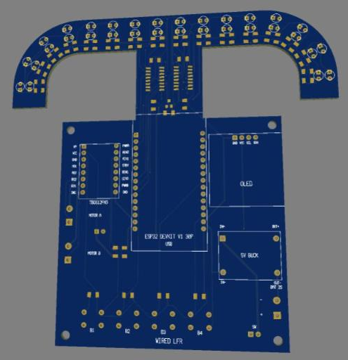
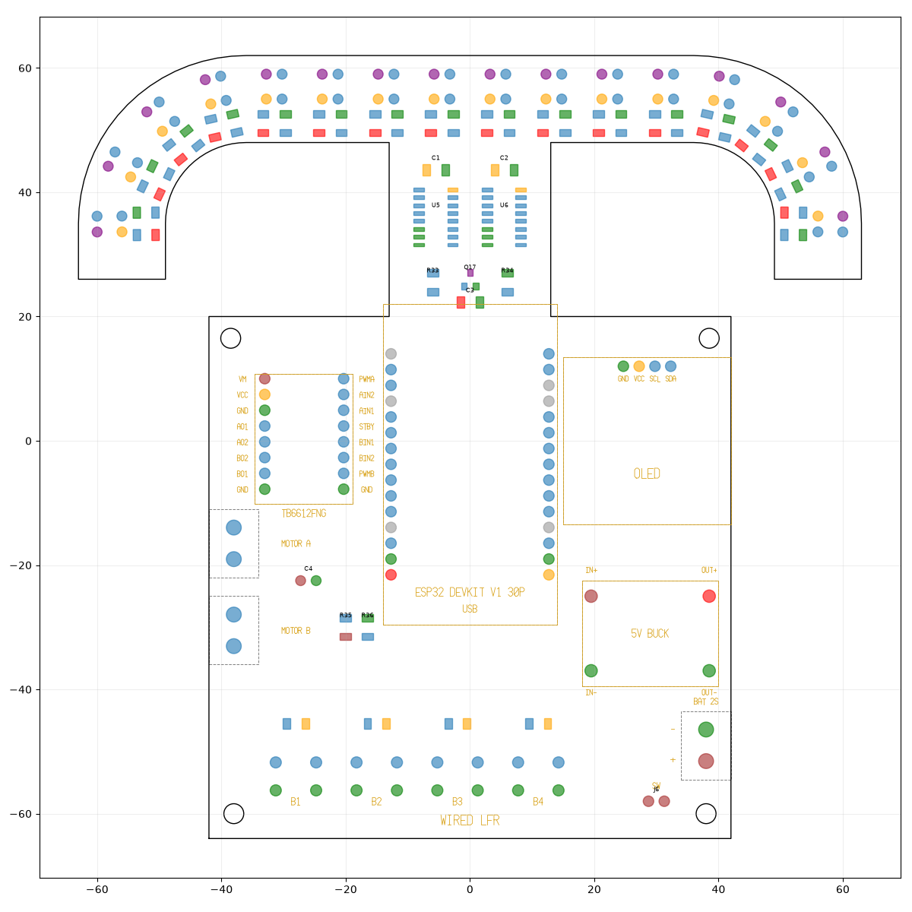

# WIRED LFR – 16-Sensor ESP32 Line Follower

A complete, single-board line follower robot for student robotics competitions.
The anchor-shaped front carries **16 visible-light sensors** (white LED + photodiode pairs);
the main section hosts a plug-in **ESP32 DevKit**, a **0.96" OLED**, a **TB6612FNG** motor driver
module, a 5 V buck regulator and four tuning buttons.

Every module sits on female headers and all parts are hand-solderable
(1206 passives, through-hole LEDs/photodiodes, SOIC multiplexers).

> **Status: design stage – not yet fabricated or tested.** Please check the
> "Before you build" list below.

## Board

| | |
|---|---|
| Size | 126 × 126 mm, 2 layers, 1.6 mm FR-4 |
| Design tool | EasyEDA Standard |
| Routing | 63 nets, all routed, DRC clean in EasyEDA |
| Mounting | 4 × M3 holes (3.2 mm) |

The LEDs and photodiodes are on the top side, so the board mounts **top side facing the floor**.

## Features

- 16 sensor channels: 3 mm clear white LED (100 Ω) + 3 mm photodiode (6.8 kΩ load)
- 2 × 74HC4051 multiplexers → 2 analog inputs + 3 select lines
- LED brightness via PWM (AO3400 MOSFET) – switch the LEDs off to measure and subtract room light
- ESP32 DevKit V1 (30-pin) on female headers, USB facing the back
- 0.96" I2C OLED on a female header
- TB6612FNG module on female headers + 2 screw terminals for motors
- 2S LiPo input (screw terminal), header for a power switch, MP1584 5 V buck module
- Battery voltage sensing (100 k / 33 k divider)
- 4 buttons with 10 k pull-ups

## ESP32 pin map

| Function | GPIO |
|---|---|
| Sensor mux output 1 (sensors 1–8) | 36 (VP) |
| Sensor mux output 2 (sensors 9–16) | 39 (VN) |
| Mux select S0 / S1 / S2 | 25 / 26 / 27 |
| Sensor LED PWM | 33 |
| Battery voltage (÷ 4.03) | 35 |
| OLED SDA / SCL | 21 / 22 |
| Motor A: PWMA / AIN1 / AIN2 | 23 / 19 / 18 |
| Motor B: PWMB / BIN1 / BIN2 | 4 / 17 / 16 |
| Motor driver STBY | 13 |
| Buttons B1 / B2 / B3 / B4 (active low) | 32 / 14 / 5 / 15 |

Sensor *n* is on mux channel Y(n−1) for sensors 1–8 and Y(n−9) for sensors 9–16.
Sensor 1 is at the left tip of the anchor in the PCB view. Because the board mounts
top side down, sensor 1 ends up on the robot's **right** when you look down at the robot.

## Manufacturing files

[`WIRED-LFR_Gerber_2026-11-06.zip`](WIRED-LFR_Gerber_2026-11-06.zip) – Gerber and drill files exported from EasyEDA
(2 layers, 126 × 126 mm, 1.6 mm). Checked against the design netlist: all 63 nets connected, no shorts,
144 component holes + 40 vias (0.3 mm), 4 × 3.2 mm mounting holes. Silkscreen includes "PCBWay".

## Parts

See [`BOM.csv`](BOM.csv) (91 parts) and [`netlist.json`](netlist.json).
The LEDs, photodiodes, ESP32 DevKit, TB6612FNG and MP1584 modules are common hobby parts;
check local stock for the 74HC4051 (SOIC-16) and AO3400 (SOT-23).

## Before you build – check against your modules

1. **ESP32 header rows** are 25.4 mm apart (common 30-pin DevKit V1). Measure yours.
2. **TB6612FNG module**: rows 12.7 mm apart, pin order
   `VM VCC GND AO1 AO2 BO2 BO1 GND` / `PWMA AIN2 AIN1 STBY BIN1 BIN2 PWMB GND`. Some clones differ.
3. **OLED pin order** is `GND VCC SCL SDA`. Some displays swap VCC and GND – this would damage it.
4. **MP1584 buck** connects to four labelled pads (IN+, IN−, OUT+, OUT−) with short wires.
   Set it to 5.0 V **before** plugging in the ESP32.
5. A few short battery-trace sections are 0.25 mm wide – fine for small N20-type motors.

## Credits

Sensor approach inspired by the open-source
[SENTINEL Mark II (QUEST)](https://github.com/khyarul/SENTINEL-MARK-II-QUEST) line follower.

Designed by Wired Robotics.
